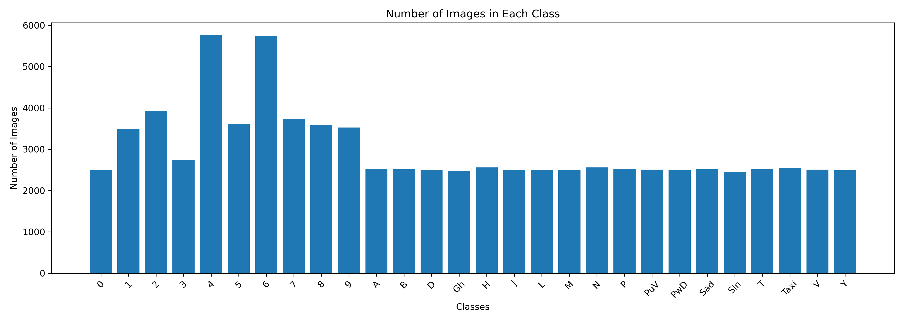
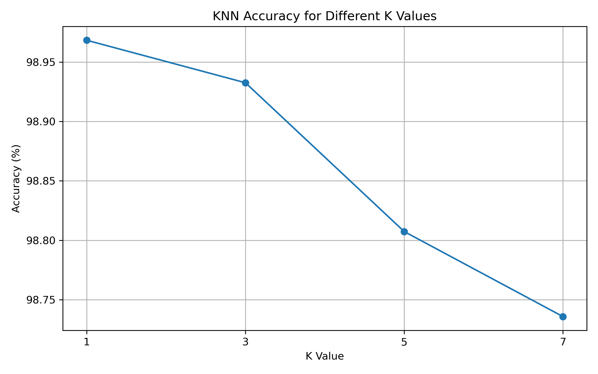
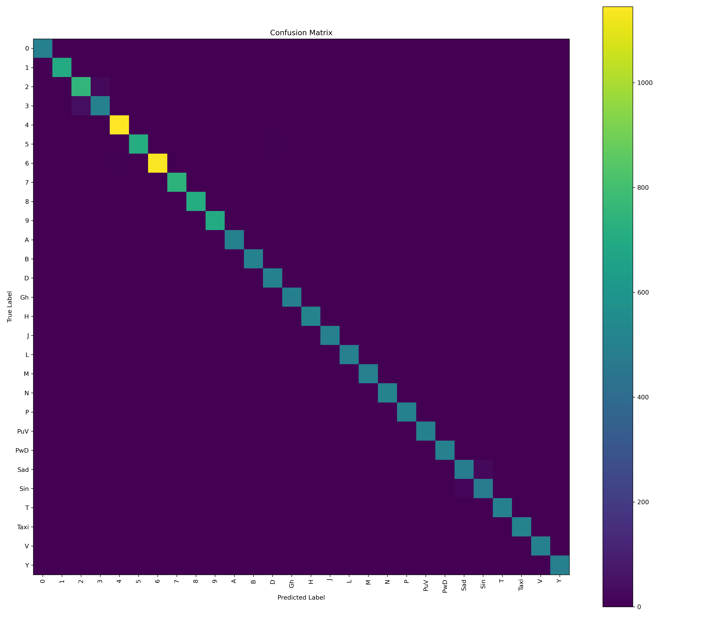

# Iranian License Plate Character Recognition

<p align="center">
  <strong>A Machine Learning-Based System for Recognizing Individual Characters Used in Iranian License Plates</strong>
</p>

<p align="center">
  
  
  
  
  
</p>

---

## Overview

**Iranian License Plate Character Recognition** is a machine learning project designed to classify individual characters used in Iranian license plates.

The project implements a complete classical machine learning workflow, from image preprocessing and feature preparation to model selection, evaluation, error analysis, model persistence, and deployment through an interactive Streamlit application.

The final classifier is based on the **K-Nearest Neighbors (KNN)** algorithm and achieves a **98.93% accuracy** on a held-out test set containing **16,769 samples**.

> **Scope:** This repository focuses on recognizing **individual characters**. Automatic license plate detection, plate localization, character segmentation, and complete plate reading are planned as future extensions.

---

## Key Results

| Metric | Result |
|---|---:|
| Final Algorithm | K-Nearest Neighbors |
| Selected K | **3** |
| Test Accuracy | **98.93%** |
| Number of Classes | **28** |
| Total Samples | **83,844** |
| Test Samples | **16,769** |
| Input Image Size | **20 × 30** |
| Features per Image | **600** |

### K-Value Comparison

| K | Test Accuracy |
|---:|---:|
| 1 | **98.97%** |
| 3 | **98.93%** |
| 5 | **98.81%** |
| 7 | **98.74%** |

Although `K = 1` achieved a marginally higher score on this specific test split, **K = 3** was selected as the final configuration to provide a more balanced neighborhood-based decision and reduce sensitivity to individual samples.

---

## System Architecture

```text
                        Input Character Image
                                  │
                                  ▼
                         Image Preprocessing
                                  │
                    ┌─────────────┴─────────────┐
                    ▼                           ▼
             Grayscale Conversion         Resize (20 × 30)
                    │                           │
                    └─────────────┬─────────────┘
                                  ▼
                           Image Flattening
                                  │
                                  ▼
                         600 Numerical Features
                                  │
                                  ▼
                           Normalization
                                  │
                                  ▼
                      KNN Classification (K = 3)
                                  │
                                  ▼
                         Predicted Character
```

---

## Machine Learning Workflow

```text
Dataset
   │
   ▼
Exploratory Analysis
   │
   ▼
Image Preprocessing
   │
   ├── Grayscale Conversion
   ├── Resize to 20 × 30
   └── Flatten to 600 Features
   │
   ▼
Train/Test Split
   │
   ▼
Feature Normalization
   │
   ▼
KNN Model Selection
   │
   ▼
Model Evaluation
   │
   ├── Accuracy
   ├── Precision
   ├── Recall
   ├── F1-Score
   └── Confusion Matrix
   │
   ▼
Error Analysis
   │
   ▼
Model Persistence
   │
   ▼
Interactive Streamlit Application
```

---

## Dataset

The dataset consists of **83,844 images** representing **28 character classes** used in Iranian license plates.

Before training, every image is processed using the following pipeline:

- Grayscale conversion
- Resize to **20 × 30 pixels**
- Flattening into **600 numerical features**
- Feature normalization

The dataset is divided into training and testing subsets using an **80/20 stratified split**.

### Dataset Distribution

<p align="center">
  
</p>

---

## Model Selection

Multiple values of `K` were evaluated during model selection.

<p align="center">
  
</p>

The final model configuration is:

```text
Algorithm: K-Nearest Neighbors
K: 3
```

---

## Model Evaluation

The final model achieved **98.93% test accuracy** on **16,769 unseen test samples**.

Performance was evaluated using:

- Accuracy
- Precision
- Recall
- F1-Score
- Confusion Matrix
- Misclassification Analysis

### Confusion Matrix

<p align="center">
  
</p>

---

## Misclassification Analysis

The most frequent classification errors were primarily observed between visually similar characters.

| True Character | Predicted Character | Errors |
|---|---|---:|
| `3` | `2` | 43 |
| `2` | `3` | 26 |
| `Sad` | `Sin` | 24 |
| `Sin` | `Sad` | 14 |
| `5` | `D` | 7 |
| `6` | `4` | 6 |

---

## Interactive Application

The project includes an interactive application built with **Streamlit**.

The application provides:

- Character image upload
- Automatic preprocessing
- KNN-based prediction
- Original and processed image comparison
- Top predictions
- Model performance metrics
- Dataset statistics
- Class distribution visualization
- K-value comparison
- Confusion matrix visualization
- Misclassification analysis

---

## Project Structure

```text
Iranian-License-Plate-Character-Recognition/
│
├── notebook/
│   └── character_recognition_knn.ipynb
│
├── models/
│   ├── knn_model.pkl
│   └── model_info.json
│
├── assets/
│   ├── class_distribution.png
│   ├── k_comparison.png
│   └── confusion_matrix.png
│
├── app.py
├── requirements.txt
└── README.md
```

---

## Installation

### Clone the Repository

```bash
git clone https://github.com/HamidNova/Iranian-License-Plate-Character-Recognition.git
```

### Navigate to the Project Directory

```bash
cd Iranian-License-Plate-Character-Recognition
```

### Create a Virtual Environment

```bash
python -m venv venv
```

Windows:

```bash
venv\Scripts\activate
```

Linux / macOS:

```bash
source venv/bin/activate
```

### Install Dependencies

```bash
pip install -r requirements.txt
```

---

## Usage

Run the Streamlit application:

```bash
streamlit run app.py
```

---

## Technologies

- Python
- NumPy
- Scikit-learn
- K-Nearest Neighbors
- Pillow
- Joblib
- Matplotlib
- Streamlit

---

## Current Limitations

The current version performs **single-character recognition** and is not yet a complete end-to-end license plate recognition system.

Real-world performance may be affected by:

- Lighting conditions
- Image noise
- Blur
- Rotation
- Perspective distortion
- Background complexity
- Camera quality
- Character segmentation quality

---

## Future Development

The planned full system architecture is:

```text
Vehicle Image
      │
      ▼
License Plate Detection
      │
      ▼
Plate Localization
      │
      ▼
Plate Cropping
      │
      ▼
Character Segmentation
      │
      ▼
Character Recognition
      │
      ▼
Complete License Plate Reading
```

Potential future improvements include:

- Automatic license plate detection
- Plate localization and cropping
- Character segmentation
- Complete plate reading
- CNN-based classification
- Deep learning models
- Real-world image support
- Video stream support

---

## Author

**Hamidreza Mirzaei**

M.Sc. Student in Computer Engineering  
Artificial Intelligence

GitHub: [github.com/HamidNova](https://github.com/HamidNova)

Email: [hamidrezamirzaei8363@gmail.com](mailto:hamidrezamirzaei8363@gmail.com)

---

## License

This project is intended for educational, research, and portfolio purposes.